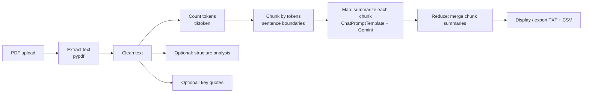

# 📄 PDF AI Summarizer

[](https://github.com/PavankumarKhot/pdfsummarizer-gemini/actions/workflows/ci.yml)

An end-to-end PDF summarizer built with **Streamlit + LangChain**, powered by **Google Gemini**.
Upload a PDF, pick a style, and get a summary, a structure analysis and optional key quotes.
A headless CLI is included so the whole pipeline can run without the UI.

## Highlights

- Extracts and cleans text from a PDF, then splits it into token-limited chunks.
- **Map-reduce summarization**: each chunk is summarized independently, then merged (batched, up to 4 in parallel).
- Four summary styles: `brief`, `detailed`, `bullet_points`, `executive`.
- Optional document-structure analysis and verbatim key-quote extraction.
- Export the summary as text and per-chunk statistics as CSV.
- Friendly handling of bad keys, rate limits, unavailable models and scanned PDFs.
- 31 offline tests (mocked LLM) plus an opt-in live Gemini test.

## Architecture



```
PDF → extract → clean → chunk ──┬── summary 1 ─┐
                                ├── summary 2 ─┼── combine → final summary
                                └── summary N ─┘
```

## Project layout

| Path | Purpose |
| --- | --- |
| `app.py` | Streamlit UI: settings, upload, progress, results, downloads |
| `cli.py` | Headless entry point: `python cli.py document.pdf` |
| `pdf_processor.py` | Extraction, cleaning, token counting, chunking, metadata |
| `prompts.py` | All `ChatPromptTemplate`s and the four styles |
| `summarizer.py` | Gemini chains: chunk summaries, combine, analysis, quotes |
| `utils.py` | Statistics, exports, API-key and error helpers |
| `config.py` | Model list, chunk bounds, concurrency |
| `tests/` | Unit, UI smoke and opt-in live tests |
| `scripts/make_sample_pdf.py` | Builds a synthetic multi-page PDF for demos |

## Quickstart

Requires **Python 3.10+** (tested on 3.12).

```powershell
# Windows (PowerShell)
python -m venv .venv
.\.venv\Scripts\Activate.ps1
pip install -r requirements.txt
Copy-Item .env.example .env      # then put your key in .env
```

```bash
# macOS / Linux
python -m venv .venv
source .venv/bin/activate
pip install -r requirements.txt
cp .env.example .env
```

Get a free API key at <https://aistudio.google.com/apikey>.

| Variable | Required | Default | Description |
| --- | --- | --- | --- |
| `GEMINI_API_KEY` | yes | – | Google AI Studio key |
| `GEMINI_MODEL` | no | `gemini-3.1-flash-lite` | Default model; can be changed in the UI |
| `MAX_CONCURRENCY` | no | `4` | Parallel chunk summaries; lower it on free-tier rate limits |

### Run the app

```powershell
streamlit run app.py
```

Then upload a text-based PDF, choose a style, and press **Process PDF**.

### Run from the CLI

```powershell
python scripts/make_sample_pdf.py                    # optional demo PDF
python cli.py samples/sample.pdf --style detailed
python cli.py report.pdf --style executive --analysis --quotes --out summary.txt
python cli.py report.pdf --json                      # machine-readable output
```

## Summary styles

| Style | Output |
| --- | --- |
| `brief` | 2–3 sentences with the main points |
| `detailed` | Topics, arguments, details and conclusions |
| `bullet_points` | Grouped, scannable bullets |
| `executive` | Insights, implications, recommendations and risks |

To add a style, add an entry to `STYLES` in `prompts.py`; it appears automatically in the
CLI and the Streamlit sidebar.

## Testing

```powershell
pip install -r requirements-dev.txt
pytest -q                 # 31 offline tests, no API calls
ruff check .

# opt-in: calls the real Gemini API
$env:RUN_LIVE_TESTS="1"; pytest tests/test_live.py -q
```

The offline suite covers text cleaning, chunk boundaries, hard splits, prompt rendering,
statistics, exports, error mapping, map-reduce behavior and a Streamlit `AppTest` smoke run.

## Troubleshooting

- **“No extractable text”** — the PDF is probably scanned images. Run OCR first
  (for example `ocrmypdf`) and retry.
- **429 / rate limit** — wait a minute, lower `MAX_CONCURRENCY`, use a smaller document,
  or switch to a lighter model.
- **Model not available / 404** — set `GEMINI_MODEL` in `.env` or pick another model in the sidebar.
- **API key not found** — make sure `.env` sits next to `app.py` and contains `GEMINI_API_KEY`.
- **Quotes or analysis missing** — those steps are optional and fail soft; the main summary still runs.

## Build phases

This project was built in gated phases:

| Phase | Scope | Status |
| --- | --- | --- |
| 0 | Validate Gemini key + GitHub login, repo scaffold, deps | ✅ |
| 1 | Project structure, config, dependency pins | ✅ |
| 2 | Headless map-reduce pipeline + CLI | ✅ |
| 3 | Streamlit UI | ✅ |
| 4 | Tests, error handling, CI | ✅ |
| 5 | Documentation and push to GitHub | ✅ |

## Security

`.env` is git-ignored and never committed. If you fork this project, add your own key and
rotate it at <https://aistudio.google.com/apikey> if it is ever exposed.
