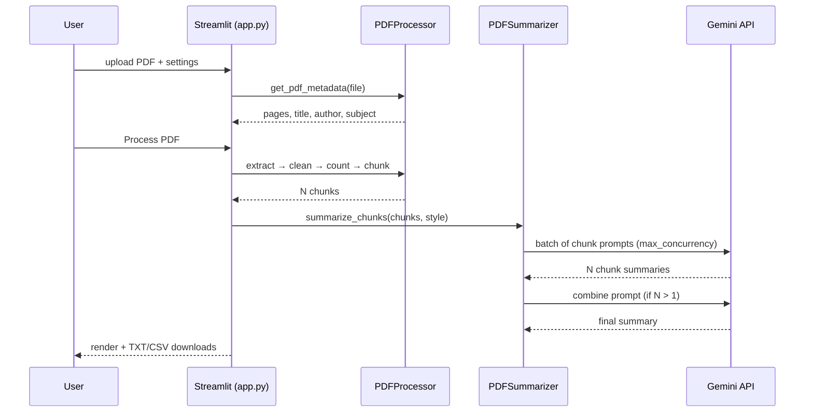

# Walkthrough: how a PDF becomes a summary

This is the learning-oriented tour of the code. For setup and usage, see `README.md`.

## 1. Request lifecycle



## 2. Extraction and cleaning (`pdf_processor.py`)

`PdfReader` walks every page and extracts text. Pages that fail are logged and skipped, so one
broken page cannot kill a whole document. `clean_text` removes control characters and collapses
runs of spaces/newlines while preserving paragraph breaks, which keeps prompts compact.

`count_tokens` uses `tiktoken`'s `cl100k_base` encoding as a cheap approximation of Gemini's
tokenizer. Exact counts are not required — the goal is to stay safely under the model's context
limit.

## 3. Chunking strategy (`PDFProcessor.chunk_text`)

1. Split on sentence boundaries with `(?<=[.!?])\s+`.
2. If a single sentence exceeds the token budget, hard-split it by tokens.
3. Greedily pack sentences into a chunk until adding the next one would exceed the budget.

Sentence-aligned chunks summarize better than arbitrary character windows because a prompt never
starts or ends mid-idea. The `+1` per piece approximates the joining space, keeping the estimate
slightly conservative.

## 4. Prompts as LangChain templates (`prompts.py`)

Every instruction lives in one place. `_template()` builds a `ChatPromptTemplate` with a shared
system persona and a human message with `{placeholders}`. The system message forbids inventing
facts, which matters more than style tuning for summarization quality.

There are four templates:

| Template | Input | Used for |
| --- | --- | --- |
| `CHUNK_SUMMARY` | `{style}`, `{text}` | map step, one call per chunk |
| `COMBINE` | `{style}`, `{summaries}` | reduce step, one call total |
| `ANALYSIS` | `{text}` | optional structure analysis |
| `QUOTES` | `{text}` | optional verbatim quotes |

## 5. Chains and batching (`summarizer.py`)

```python
self.chunk_chain = CHUNK_SUMMARY | self.llm | RunnableLambda(message_text)
```

- `|` composes Runnables: template → model → parser.
- `RunnableLambda(message_text)` normalizes responses across `langchain-google-genai` versions,
  where Gemini 3 may return a list of content blocks instead of a plain string.
- `.batch(inputs, config={"max_concurrency": 4}, return_exceptions=True)` sends several chunk
  prompts at once. `return_exceptions=True` is deliberate: one failed chunk is recorded as
  `ok=False` instead of aborting the run.
- `combine_summaries` skips the reduce call when only one chunk succeeded, and falls back to
  concatenated sections if the merge call itself fails.

`PDFSummarizer(llm=...)` accepts an injected model, which is how the offline tests run the real
chains against a fake `RunnableLambda` without network calls.

## 6. State and caching in Streamlit (`app.py`)

- `@st.cache_resource` keeps the tokenizer and the model client alive across reruns.
- Results are stored in `st.session_state` so clicking a download button does not re-run the LLM.
- A signature of `(file_id, style, max_tokens, analysis, quotes, model)` clears stale results
  whenever the input or a setting changes.

## 7. Errors that matter

| Failure | Behavior |
| --- | --- |
| Missing/short key | UI stops with a setup hint; CLI exits with code 2 |
| Scanned PDF | `chunk_text` raises “No extractable text”; UI shows it, CLI exits 1 |
| Some chunks fail | Run continues, failures shown per chunk with the API error |
| All chunks fail | “No valid summaries were generated.”; CLI exits 1 |
| 429 / 403 / 404 | `describe_api_error` maps them to actionable messages |

## 8. Where to extend

- **New style**: add one entry to `STYLES` in `prompts.py`.
- **OCR**: detect empty text and call an OCR tool before cleaning.
- **Caching / cost**: memoize summaries by file hash.
- **Longer prompts**: add overlap between chunks for cross-boundary context.
- **Other providers**: swap `ChatGoogleGenerativeAI` for another LangChain chat model; the
  prompts and pipeline stay unchanged.

## 9. Testing strategy

- Pure functions (cleaning, chunking, stats, exports) are tested directly.
- Chains are tested by injecting `RunnableLambda` fakes, including a flaky one that fails a
  single chunk.
- The UI is smoke-tested with Streamlit's `AppTest`, which executes `app.py` headlessly.
- One live test is opt-in via `RUN_LIVE_TESTS=1` so routine test runs never spend API quota.
